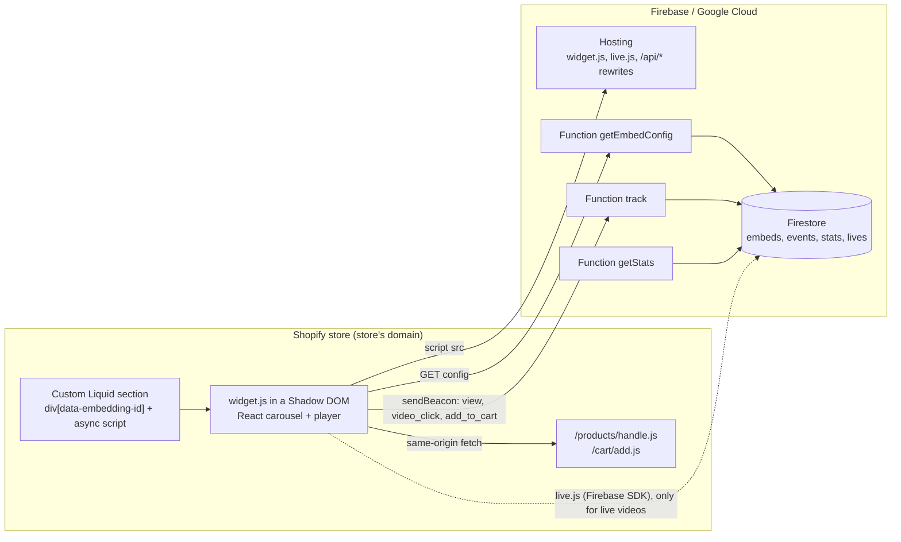

# Shoppable video widget (proof of concept)

An embeddable carousel of short vertical videos for a Shopify store. Tapping a video opens a full-screen player with the tagged product and a real **Add to cart**. A "live" video also shows realtime chat and a poll. Views, clicks and add-to-carts are tracked, and one number answers "how much cart value did the videos drive?".

Built to understand how a product like Terrific works technically. Not a store: no accounts, payments, admin UI or video pipeline.

## Run it locally

Needs Node 22+ and Java (for the Firestore emulator).

```bash
npm install
npm run emulators        # builds widget + functions, starts Firestore, Functions, Hosting
npm run seed             # in a second terminal: loads sample embeds + a live room
```

Open http://127.0.0.1:5002 (fake store page, mock products) and http://127.0.0.1:4000 (Emulator UI).

```bash
npm test -w widget && npm test -w functions && npm run typecheck -w widget
```

## How it works



1. The store page has a `<div data-source="poc" data-embedding-id="home-carousel">` and an `async` script tag.
2. `widget.js` finds each div, attaches a Shadow DOM, and renders the carousel with React.
3. It fetches the config for that embedding id from the `getEmbedConfig` function (Firestore `embeds/{id}`): videos, product handles, theme color. A new client is a new document, not a new build.
4. Product title, price, image and stock come from the store itself (`/products/{handle}.js`). Add to cart is `POST /cart/add.js`. Both are same-origin because the widget runs on the store's domain.
5. Events go out with `navigator.sendBeacon` to `track`, which stores the raw event and bumps counters in `stats/{embeddingId}` in one batch. `getStats` returns them.
6. If a video has a `liveId`, opening it loads `live.js` (the Firebase SDK) and opens realtime listeners for chat and poll.

## Key technical decisions

| Topic | Decision | Why |
|---|---|---|
| SDK bundle | Vite library mode, `iife` format, one `widget.js` | A plain `<script src>` can't use ES modules or imports. `process.env.NODE_ENV` is baked in with `define` because React reads it and a browser has no `process`. |
| CSS isolation | Shadow DOM, CSS imported with `?inline` and injected into the shadow root | The store theme can't restyle us. `:host { all: initial }` stops inherited fonts and colors. Buttons need `font: inherit` because they don't inherit it. |
| No layout shift | Reserved height is **inline on the host div in the store's HTML** | CSS inside the shadow root only applies after JS runs, which is too late to prevent CLS. |
| Page speed | `async` script, videos get `src` only near the viewport, only videos ≥60% visible play (muted), one IntersectionObserver pair per card | Nothing blocks rendering and hidden videos cost no bandwidth. |
| Failure handling | 4s config timeout, response shape check, React error boundary, all end in `display: none` on the host | The store page must never break because of us. |
| Firebase SDK | Separate `live.js`, loaded on demand | An IIFE bundle can't code-split. The carousel stays small and only live videos pay for Firestore. |
| Tracking transport | `sendBeacon` with JSON as `text/plain` | The browser queues it even when the page closes, and `text/plain` is a CORS "simple request" so there is no preflight. The function parses the raw body itself. |
| Config delivery | Hosting rewrites `/api/*` to functions; the widget derives the API origin from its own script URL | Same-origin on our side; `cors: true` on the functions because the widget runs on the store's origin. |
| Live data | Firestore `onSnapshot` listeners, security rules allow only chat and vote creation | Browsers never get write access to anything else. |

### Bundle size (gzip)

| File | Size | Loaded |
|---|---|---|
| `widget.js` | ~70 KB (React + ReactDOM are most of it) | Always |
| `live.js` | ~143 KB (Firebase Firestore SDK) | Only when a live video opens |

`npm run build -w widget` prints the current numbers.

## Trade-offs I made (and the honest limits)

- **Attribution is naive.** Cart value counts add-to-cart events fired from the player. It is not purchase revenue: there is no order or checkout link, and the same shopper can add the same item twice.
- **Price comes from the browser.** The `value` in `add_to_cart` is sent by the client, so it can be forged. Fine for a PoC; real revenue must come from Shopify order data.
- **No rate limiting or bot filtering** on `track`, and `track` accepts any embedding id. Validation only checks shape.
- **One vote per session id, not per person.** Votes are create-only docs keyed by a random per-page-load id. A new page load can vote again. Real prevention needs authentication.
- **Poll tallied in the client** by reading the votes subcollection. Fine for hundreds of voters, wasteful for thousands.
- **First available variant only.** No variant picker, no quantity, no multi-currency stats.
- **Theme cart UI isn't refreshed.** `/cart/add.js` changes the cart, but the theme's cart count or drawer doesn't update. Real apps use the Section Rendering API or theme-specific events.
- **Pasted Custom Liquid vs a real app.** A production app would ship a **theme app extension** (an app embed block): merchants toggle it in the theme editor, Shopify serves the script, settings become block fields, and it survives theme changes. Pasted snippets break when the theme is replaced.
- **Cache vs schema.** `widget.js` is cached for 5 minutes. During development an old bundle received a new config shape and crashed; the error boundary hid the widget cleanly, but it shows why config schema changes must stay backward compatible or use versioned filenames.
- **Failure collapses the reserved space.** On error the host is hidden, so content below shifts up once.
- **Video** is plain `<video>` with MP4. No adaptive bitrate.

## What I would do differently at scale

- **CDN and versioned assets.** Serve `widget.js` from a CDN with content-hashed filenames and a tiny stable loader that points at the current hash. Config responses cached at the edge with short TTLs and stale-while-revalidate.
- **HLS.** Transcode uploads to HLS (several bitrates, 1-2 second segments) and play with native HLS or hls.js. Add posters, preview clips and `preload` rules so the first frame appears fast on slow networks.
- **Event pipeline.** `track` should only validate and publish to **Pub/Sub**. A subscriber (Dataflow or a function) writes to **BigQuery**. Revenue and funnels come from BigQuery plus Shopify order webhooks (using cart attributes or UTM-like tags to join a purchase back to a video), not from Firestore counters.
- **Abuse protection.** Per-IP and per-embedding rate limits (Cloud Armor or API Gateway), App Check for the Firestore listeners, signed embedding ids, an allow-list of origins per client.
- **Live at scale.** Firestore listeners get expensive and hit per-document write limits in busy rooms. Move chat to a purpose-built realtime layer (or sharded Firestore docs), aggregate votes with a function trigger, and add moderation.
- **Multi-tenant config.** Per-client auth, an admin UI, schema versioning for configs, and per-tenant limits.
- **Observability.** Real user monitoring for LCP, CLS and INP of the widget on customer sites, error reporting from the widget (sampled), and a canary page per release.
- **Accessibility and motion.** Honor `prefers-reduced-motion` for autoplay, captions on videos, and focus-trap tests for the player dialog.

## Project layout

```
widget/      React + TypeScript widget (Vite library mode), tests with Vitest + Testing Library
functions/   Cloud Functions (Node + TypeScript): getEmbedConfig, track, getStats, event validation + test
firebase/    Firestore rules, seed data and script (firebase.json and .firebaserc live at the repo root: the CLI only deploys folders inside its project directory)
shopify/     custom-liquid.html: the snippet to paste into a theme
```

## Putting it on a real store

1. Copy `functions/.env.example` to `functions/.env` and fill in your Firebase web API key.
2. Deploy: `npx firebase deploy --project <id>` from the repo root with a real project (Cloud Functions need the Blaze plan; set the `WEB_API_KEY` env var for the live bundle).
3. Replace the seed `productHandles` with handles that exist in your store, and seed Firestore in the real project.
4. Paste `shopify/custom-liquid.html` into a Custom Liquid section, replacing `YOUR_HOST` with your Hosting domain.
