# Shoppable video widget (proof of concept)

[](https://github.com/evavargas/shoppable-video-poc/actions/workflows/ci.yml)

**Live demo:** https://terry-shop.web.app is a fictional bakery store (Hearth & Crumb) with the widget embedded.
The page simulates a merchant's theme and its products are Shopify-shaped JSON files; the config, live chat, poll and stats are real (Firestore + Cloud Functions).

> **Status:** everything described below is deployed at `terry-shop.web.app`: hotspots, the stories layout, the floating live mini-player and the live extras (viewer count, hearts, pinned product).
> What is planned next (a timed coupon drop, an upcoming-live card and a host control page) and the deploy checklist are in [`docs/ROADMAP.md`](docs/ROADMAP.md).

| Demo page | What it shows |
|---|---|
| [`/`](https://terry-shop.web.app/) | The store: "Watch & shop" carousel, product grid, cart count that reacts to the widget |
| [`/dashboard.html`](https://terry-shop.web.app/dashboard.html) | Views, clicks, add-to-carts, cart value and CTR, refreshed every 5 s |
| [`/isolation-test.html`](https://terry-shop.web.app/isolation-test.html) | The same widget on a page with deliberately hostile CSS (red serif text, hot pink buttons): proof that the Shadow DOM isolates it |

| Store page (desktop) | Store page (mobile) | Live video in the player |
|---|---|---|
| 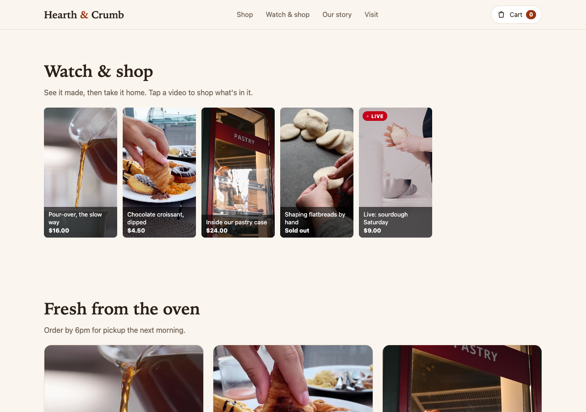 | 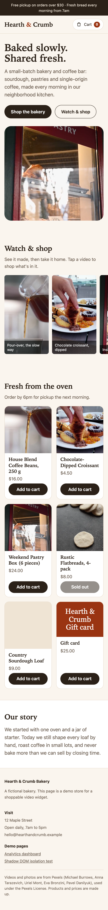 | 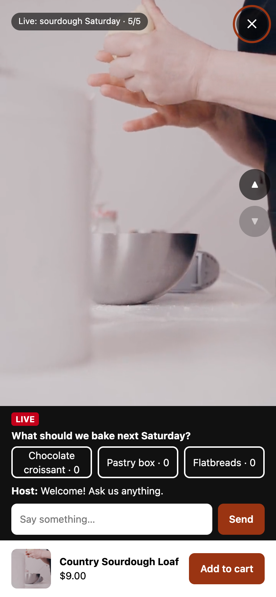 |

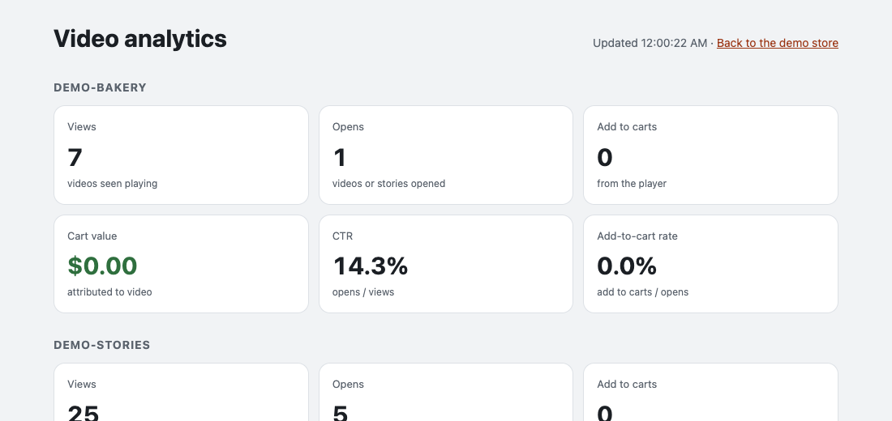

## What the widget does

| Feature | How |
|---|---|
| Carousel with posters, price and LIVE badge | Poster first; the price is read from the store (`/products/{handle}.js`) only when a card is near the viewport; live videos get a pulsing badge |
| Autoplay only what is visible | IntersectionObserver: videos get `src` when near, play at 60% visible, pause when not |
| Full-screen player | Native `<dialog>` (focus trap, Esc), open/close animation, product card with Add to cart |
| Swipe between videos | Swipe up/down on touch, Arrow keys, or the on-screen buttons. Each opened video is tracked as a `video_click` |
| Live extras | Viewer count ("N watching"), hearts that float over the video, and a product the host pins in real time (see below) |
| Floating live mini-player | `layout: "floating"`: a small player in the corner of every page while a live is on; dismissible for the session; expands into the full player (see below) |
| Stories layout | `layout: "stories"` in the config turns the carousel into a row of round avatars; the same full-screen player opens with progress bars and auto-advance (see below) |
| Timed product hotspots | A tappable chip on the video between `start` and `end` seconds at `x`/`y` percent; tapping opens a product card over the video (see below) |
| Live chat + poll | Firestore listeners in a separate, lazily loaded `live.js` |
| Cart count in the store header | After a successful add, the widget dispatches a `poc:cart-add` event (see below) |
| Reduced motion | `prefers-reduced-motion` turns off animations and autoplay previews |
| Resilience | Any failure (config, products, Firebase) hides the widget or the live panel; the store page keeps working |

### Live extras: viewer count, hearts and pinned product

Three small real-time features in the live panel. They all live in the lazily loaded `live.js`, and each one stops when the player closes.

| Extra | Data in Firestore | How it works |
|---|---|---|
| **N watching** | `lives/{id}/viewers/{sessionId}` = `{ lastSeen }` | Every open player writes a heartbeat when it joins and every 30 s (not while the tab is hidden), and deletes it on leaving. The client listens to the newest 100 docs and counts those seen in the last 75 s. A timer recounts every 15 s, because nothing changes in the database when someone silently leaves. Shows `100+` when the capped query is full. |
| **Hearts** | `lives/{id}/reactions/{auto}` = `{ type, count, sessionId, at }` | Every tap animates a heart at once, but taps are counted and written **at most once per second** as one document with `count` (max 20). Other viewers' batches float `min(count, 8)` hearts. History is never replayed (the first snapshot is ignored), the screen is capped at 30 hearts, and a timer removes hearts even if the CSS animation never runs. Reduced motion: nothing floats, only the counter changes. |
| **Pinned product** | `lives/{id}.pinnedProduct` = a product handle or `null` | The same document listener the mini-player uses. The player shows a highlighted "Pinned by the host" card above the product list, announces changes politely (`role="status"`), validates the handle before using it, and shows nothing if the product can't be loaded. Add to cart from it is tracked like any other. |

Analytics: a `reaction` event per flushed batch, with its `count`; the dashboard shows the `reactions` total.

Security (see `firebase/firestore.rules`): viewers can only write their own heartbeat with the server time; reactions are create-only, `type == 'heart'`, `count` an integer 1 to 20, server time; nobody but the Admin SDK can write the live document, so a viewer can't pin a product. I checked the rules by hand against the emulator (oversized count, extra field, wrong keys and a bad id are rejected, and so is writing `pinnedProduct`). Automated rules tests are still on the roadmap.

**Cost and limits, honestly:**
- **Heartbeats:** each client listens to the viewers collection, so one heartbeat causes one read per connected viewer: the cost grows with the square of the audience. The query cap (100) bounds it, which is fine for a PoC. At scale a scheduled Cloud Function would write one `viewerCount` field every 10 s and clients would listen to that single document, with a Firestore TTL policy deleting stale heartbeats. The textbook tool is Realtime Database presence (`onDisconnect`), at the price of a second database.
- **Hearts:** batching turns "one write per tap" into "one write per viewer per second". A very large audience would aggregate counts in a function instead of storing every batch.
- **No auth:** anyone can delete a heartbeat, which can only lower a counter. A pinned product is only as trustworthy as the host's write access (the host control page and real auth are feature 7 on the roadmap).

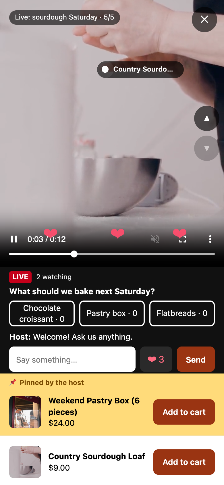

### Floating live mini-player

A third layout, `"floating"`, for an embedding that is placed once on every page of the store (in the theme layout). It renders nothing inline; while a live is on it shows a small muted preview bottom-right.
Tap it and the full player opens on the live video (with chat and poll); close the player and the mini-player comes back. The ✕ dismisses it for the rest of the browser session.

```html
<div data-source="poc" data-embedding-id="demo-live" data-layout="floating"></div>
```

The live is a Firestore document, `lives/{liveId}`, with a `status` field: `"live"`, `"scheduled"` or `"ended"`. The embedding's video that has a `liveId` is the one shown.
To try it locally, change `status` in the Emulator UI (http://127.0.0.1:4000, Firestore, `lives/bakery-live`): the mini-player disappears and comes back in real time.

**Staying cheap and lazy.** The mini-player is on every page, so what it costs when nothing is happening matters most:

1. **Dismissed this session:** it does nothing at all. No request, no Firebase.
2. **Otherwise:** one tiny request, `GET /api/liveStatus?id=…` (a Cloud Function that returns `{ "status": "live" }`, cached 5 s at the browser and CDN). If no live is on, it stops there.
3. **Only when a live is on:** it loads `live.js` (the Firebase SDK) and opens one real-time listener on `lives/{liveId}`, so it disappears when the host ends the live and returns if the host restarts it.

Why not just open the listener? A Firestore listener holds a connection and bills a read per change. Multiplied by every visitor on every page, that is real money for something that is usually off.
The trade-off: the check is a snapshot, so a live that starts while the page is already open won't show until the next page load (or a 5 s-cached re-check, which I did not add). A production version would poll `liveStatus` every 30-60 s or push the state over a single shared connection.

The host div has `data-layout="floating"` and no height, and `:host` drops `contain: layout` for it, because layout containment would make the host the containing block of the `position: fixed` mini-player and pin it inside the tiny host instead of the viewport.

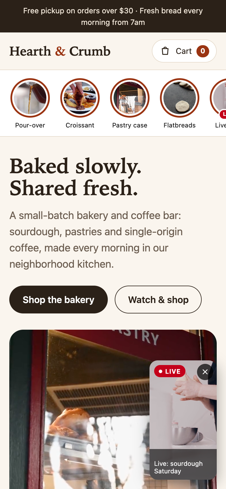

### Stories layout (Instagram-style Timeline)

The same embedding mechanism, a different `layout` in the Firestore document:

```json
{ "layout": "stories", "theme": { "accent": "#9a3412" },
  "videos": [ { "id": "v1", "label": "Pour-over", "title": "Pour-over, the slow way", "poster": "/media/coffee-pour.jpg", "src": "...", "productHandles": ["..."] } ] }
```

- **Avatars:** round, ringed in the accent colour, from the poster image (no video is downloaded until a story is opened). `label` is the short name under the circle (falls back to `title`). A live story gets a red LIVE badge.
- **Seen state:** opened stories turn grey for the rest of the browser session (`sessionStorage`, guarded: blocked storage just means no memory).
- **Player:** the same component as the carousel, plus segmented progress bars. Stories play once (`loop` off); when one ends the next starts, and the last one closes the player. Hotspots, live chat and Add to cart all work inside stories.
- **No layout shift:** the layout is only known after the config loads, so the merchant's div says it up front: `data-layout="stories"` with an inline `min-height: 104px`. The loading skeleton and `:host` height then match the final row. Without the hint the widget assumes the carousel, and a stories embedding would grow once when its config arrives.
- **Tracking:** opening a story is `story_open` (not `video_click`); the dashboard's "Opens" card adds both, so CTR is comparable between layouts.

```html
<div data-source="poc" data-embedding-id="demo-stories" data-layout="stories" style="min-height: 104px"></div>
```

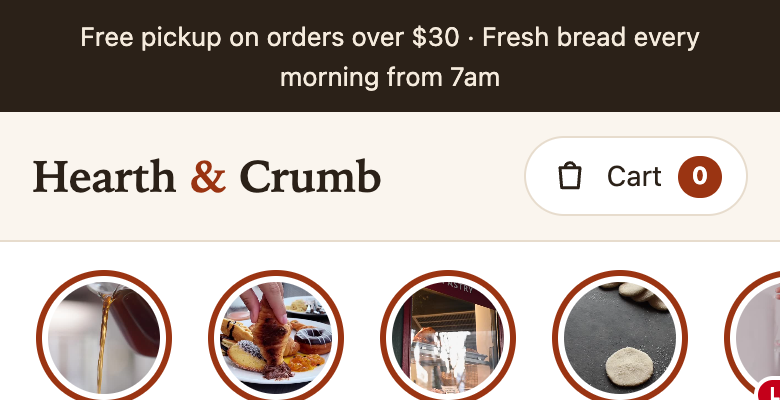
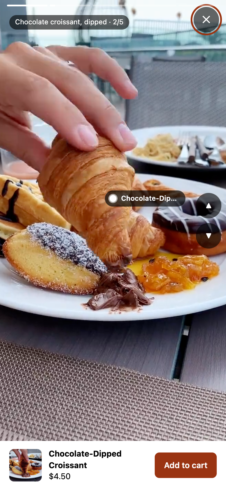

### Timed product hotspots ("shop the look" on video)

Each video can list hotspots. A hotspot points at one of the video's `productHandles` and says when and where to show a chip:

```json
{
  "id": "v3",
  "src": "/media/pastry-case.mp4",
  "productHandles": ["weekend-pastry-box", "chocolate-croissant"],
  "hotspots": [
    { "handle": "chocolate-croissant", "start": 1, "end": 9,  "x": 33, "y": 48 },
    { "handle": "weekend-pastry-box",  "start": 3, "end": 10, "x": 62, "y": 76 }
  ]
}
```

`x` and `y` are percentages of the frame (0 to 100), so they stay on the object at any screen size. `end` is exclusive.
The product's title and price come from the store, never from the config.

How it works: the `HotspotLayer` listens to the video's `timeupdate` event (about 4 times a second) and keeps the current time in its own state,
so the player and the chat don't re-render. Tapping a chip pauses the video, opens the product card, and sends a `hotspot_click` event;
closing the card resumes playback. Esc closes the card first and the player on the next press.
The list of products under the video stays as the keyboard and screen-reader fallback, because chips come and go with the playback.

Hotspots come from the network, so `sanitizeHotspots` validates each one (known product, `start` < `end`, positions in range) and drops only the invalid ones:
a typo in one hotspot can't remove the others or the video. Events are validated again on the server (`parseEvent`).

| Player with two hotspots | Product card opened from a hotspot |
|---|---|
| 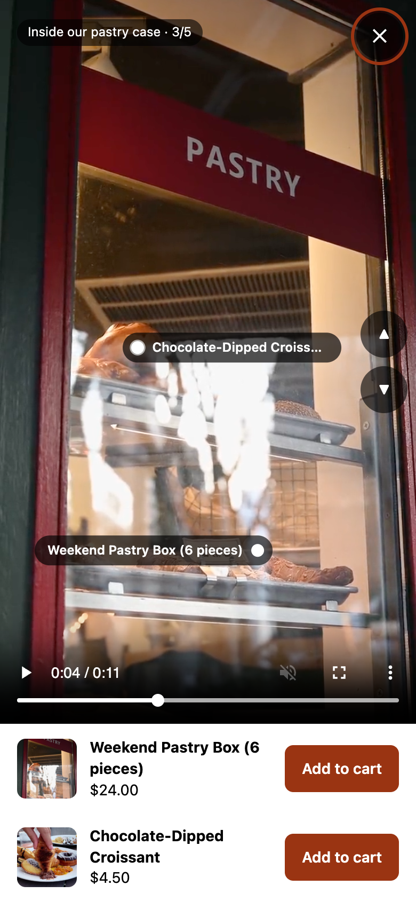 | 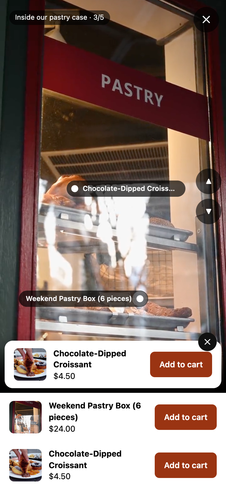 |

### One widget, many embeddings

Each embedding id is a Firestore document, so the same `widget.js` serves different stores. This repo seeds two:
`demo-bakery` (the fictional store above, with Shopify-shaped mock products) and `home-carousel` (a real Shopify development store).
Adding a client is adding a document; no build or deploy.

### Updating the store's cart count

A widget can't know how a theme draws its cart, so after a successful `/cart/add.js` it dispatches a DOM event on `window`:

```js
window.addEventListener('poc:cart-add', (e) => {
  // e.detail = { handle, title, price, currency, count }  (count = Shopify's cart item_count when available)
});
```

The demo page listens and updates its header badge. On a real Shopify theme the listener would use the **Section Rendering API**:
`fetch(`${Shopify.routes.root}?sections=cart-icon-bubble`)` returns the HTML of the theme's own cart-count section already rendered by Liquid,
and the listener swaps it into the header. That keeps the markup, translations and styling owned by the theme.

### Media credits

Videos and product photos are frames and clips from [Pexels](https://www.pexels.com/) creators, used under the [Pexels License](https://www.pexels.com/license/) (free to use and modify, attribution not required but given):
Michael Burrows ([coffee pour](https://www.pexels.com/video/pouring-black-coffee-into-a-cup-7118100/)),
Anna Tarazevich ([croissant](https://www.pexels.com/video/a-person-dipping-a-croissant-on-chocolate-6741736/)),
Uriel Mont ([pastry case](https://www.pexels.com/video/a-low-angle-shot-of-a-pastry-shop-6307657/)),
Eva Bronzini ([flatbreads](https://www.pexels.com/video/a-person-shaping-the-dough-using-rolling-pin-7237140/)),
Pavel Danilyuk ([kneading](https://www.pexels.com/video/a-person-kneading-dough-6942821/)).
They are trimmed to 12 s, re-encoded to 720p H.264 and stripped of audio. These files are not covered by this repository's code license. The brand, products and prices are fictional.

An embeddable carousel of short vertical videos for a Shopify store. Tapping a video opens a full-screen player with the tagged product and a real **Add to cart**. A "live" video also shows realtime chat and a poll. Views, clicks and add-to-carts are tracked, and one number answers "how much cart value did the videos drive?".

Built to understand how a product like Terrific works technically. Not a store: no accounts, payments, admin UI or video pipeline.

## Run it locally

Needs Node 22+ and Java (for the Firestore emulator).

```bash
npm install
npm run emulators        # builds widget + functions, starts Firestore, Functions, Hosting
npm run seed             # in a second terminal: loads sample embeds + a live room
```

Open http://127.0.0.1:5002 (fake store page, mock products) and http://127.0.0.1:4000 (Emulator UI).

```bash
npm test -w widget && npm test -w functions && npm run typecheck -w widget
```

## How it works

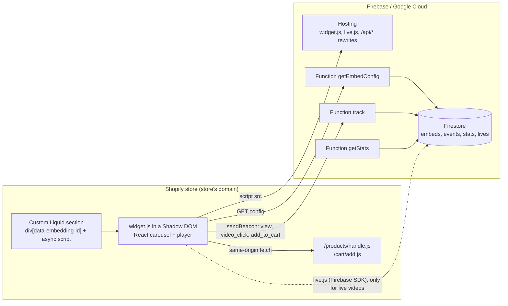

1. The store page has a `<div data-source="poc" data-embedding-id="home-carousel">` and an `async` script tag.
2. `widget.js` finds each div, attaches a Shadow DOM, and renders the carousel with React.
3. It fetches the config for that embedding id from the `getEmbedConfig` function (Firestore `embeds/{id}`): videos, product handles, theme color. A new client is a new document, not a new build.
4. Product title, price, image and stock come from the store itself (`/products/{handle}.js`). Add to cart is `POST /cart/add.js`. Both are same-origin because the widget runs on the store's domain.
5. Events go out with `navigator.sendBeacon` to `track`, which stores the raw event and bumps counters in `stats/{embeddingId}` in one batch. `getStats` returns them.
6. If a video has a `liveId`, opening it loads `live.js` (the Firebase SDK) and opens realtime listeners for chat and poll.

## Key technical decisions

| Topic | Decision | Why |
|---|---|---|
| SDK bundle | Vite library mode, `iife` format, one `widget.js` | A plain `<script src>` can't use ES modules or imports. `process.env.NODE_ENV` is baked in with `define` because React reads it and a browser has no `process`. |
| CSS isolation | Shadow DOM, CSS imported with `?inline` and injected into the shadow root | The store theme can't restyle us. `:host { all: initial }` stops inherited fonts and colors. Buttons need `font: inherit` because they don't inherit it. |
| No layout shift | Reserved height is **inline on the host div in the store's HTML** | CSS inside the shadow root only applies after JS runs, which is too late to prevent CLS. |
| Page speed | `async` script, videos get `src` only near the viewport, only videos ≥60% visible play (muted), one IntersectionObserver pair per card | Nothing blocks rendering and hidden videos cost no bandwidth. |
| Failure handling | 4s config timeout, response shape check, React error boundary, all end in `display: none` on the host | The store page must never break because of us. |
| Firebase SDK | Separate `live.js`, loaded on demand | An IIFE bundle can't code-split. The carousel stays small and only live videos pay for Firestore. |
| Tracking transport | `sendBeacon` with JSON as `text/plain` | The browser queues it even when the page closes, and `text/plain` is a CORS "simple request" so there is no preflight. The function parses the raw body itself. |
| Config delivery | Hosting rewrites `/api/*` to functions; the widget derives the API origin from its own script URL | Same-origin on our side; `cors: true` on the functions because the widget runs on the store's origin. |
| Live data | Firestore `onSnapshot` listeners, security rules allow only chat and vote creation | Browsers never get write access to anything else. |

### Bundle size (gzip)

| File | Size | Loaded |
|---|---|---|
| `widget.js` | ~75 KB (React + ReactDOM are most of it) | Always |
| `live.js` | ~143 KB (Firebase Firestore SDK) | Only when a live video opens |

`npm run build -w widget` prints the current numbers.

## Trade-offs I made (and the honest limits)

- **Attribution is naive.** Cart value counts add-to-cart events fired from the player. It is not purchase revenue: there is no order or checkout link, and the same shopper can add the same item twice.
- **Price comes from the browser.** The `value` in `add_to_cart` is sent by the client, so it can be forged. Fine for a PoC; real revenue must come from Shopify order data.
- **No rate limiting or bot filtering** on `track`, and `track` accepts any embedding id. Validation only checks shape.
- **One vote per session id, not per person.** Votes are create-only docs keyed by a random per-page-load id. A new page load can vote again. Real prevention needs authentication.
- **Poll tallied in the client** by reading the votes subcollection. Fine for hundreds of voters, wasteful for thousands.
- **First available variant only.** No variant picker, no quantity, no multi-currency stats.
- **The theme's cart UI is the theme's job.** The widget only announces a cart change (`poc:cart-add`); each theme (or an app block) must listen and refresh its own cart count or drawer, ideally with the Section Rendering API.
- **Pasted Custom Liquid vs a real app.** A production app would ship a **theme app extension** (an app embed block): merchants toggle it in the theme editor, Shopify serves the script, settings become block fields, and it survives theme changes. Pasted snippets break when the theme is replaced.
- **Cache vs schema.** `widget.js` is cached for 5 minutes. During development an old bundle received a new config shape and crashed; the error boundary hid the widget cleanly, but it shows why config schema changes must stay backward compatible or use versioned filenames.
- **Failure collapses the reserved space.** On error the host is hidden, so content below shifts up once.
- **Video** is plain `<video>` with a short MP4 per clip, served from Hosting. No adaptive bitrate.

## What I would do differently at scale

- **CDN and versioned assets.** Serve `widget.js` from a CDN with content-hashed filenames and a tiny stable loader that points at the current hash. Config responses cached at the edge with short TTLs and stale-while-revalidate.
- **HLS.** Transcode uploads to HLS (several bitrates, 1-2 second segments) and play with native HLS or hls.js. Add posters, preview clips and `preload` rules so the first frame appears fast on slow networks.
- **Event pipeline.** `track` should only validate and publish to **Pub/Sub**. A subscriber (Dataflow or a function) writes to **BigQuery**. Revenue and funnels come from BigQuery plus Shopify order webhooks (using cart attributes or UTM-like tags to join a purchase back to a video), not from Firestore counters.
- **Abuse protection.** Per-IP and per-embedding rate limits (Cloud Armor or API Gateway), App Check for the Firestore listeners, signed embedding ids, an allow-list of origins per client.
- **Live at scale.** Firestore listeners get expensive and hit per-document write limits in busy rooms. Move chat to a purpose-built realtime layer (or sharded Firestore docs), aggregate votes with a function trigger, and add moderation.
- **Multi-tenant config.** Per-client auth, an admin UI, schema versioning for configs, and per-tenant limits.
- **Observability.** Real user monitoring for LCP, CLS and INP of the widget on customer sites, error reporting from the widget (sampled), and a canary page per release.
- **Accessibility and motion.** Honor `prefers-reduced-motion` for autoplay, captions on videos, and focus-trap tests for the player dialog.

## Project layout

```
widget/      React + TypeScript widget (Vite library mode), tests with Vitest + Testing Library.
             widget/public/ is the demo site: store page, dashboard, isolation test, media/ and Shopify-shaped products/*.js
functions/   Cloud Functions (Node + TypeScript): getEmbedConfig, track, getStats, event validation + test
firebase/    Firestore rules, seed data and script (firebase.json and .firebaserc live at the repo root: the CLI only deploys folders inside its project directory)
shopify/     custom-liquid.html: the snippet to paste into a theme
```

## Putting it on a real store

1. Copy `functions/.env.example` to `functions/.env` and fill in your Firebase web API key.
2. Deploy: `npx firebase deploy --project <id>` from the repo root with a real project (Cloud Functions need the Blaze plan; set the `WEB_API_KEY` env var for the live bundle).
3. Replace the seed `productHandles` with handles that exist in your store, and seed Firestore in the real project.
4. Paste `shopify/custom-liquid.html` into a Custom Liquid section, replacing `YOUR_HOST` with your Hosting domain.
